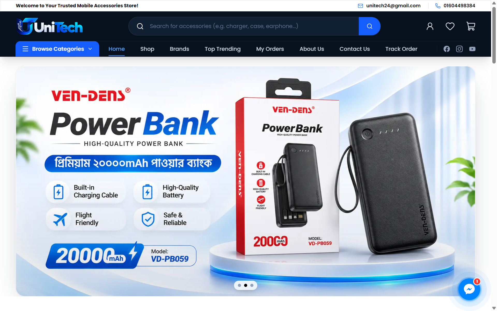
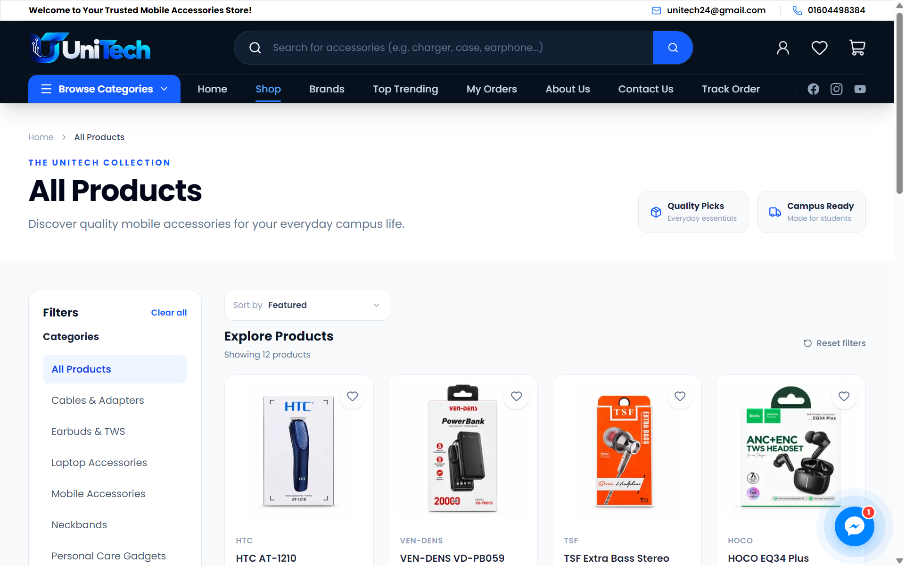
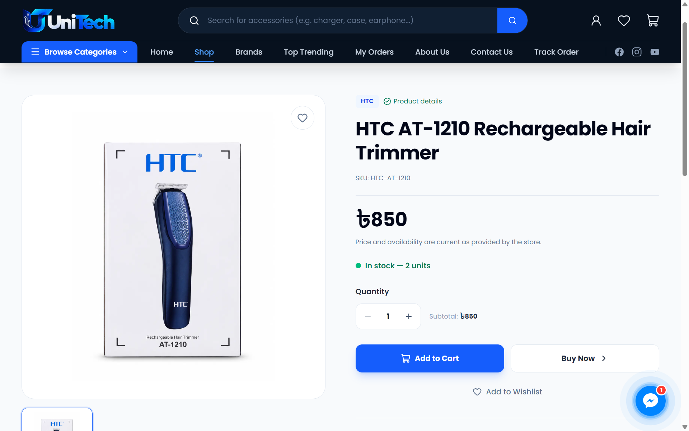

# UniTech

### Mobile accessories, made easier to discover and shop.

UniTech is an online storefront for mobile accessories, created for people who want a simpler way to find the everyday tech essentials they need. It brings products from different categories and brands into one place, with clear product information and a straightforward path from browsing to ordering.

The experience is designed with students and the NSTU community in mind, while remaining useful to anyone shopping for mobile accessories.

**Live website:** [https://unitech24.vercel.app](https://unitech24.vercel.app)

## Website Preview

## What UniTech Helps With

Finding the right accessory can mean searching across many stores, comparing scattered product details, and contacting sellers just to understand basic availability. UniTech makes that process more convenient by bringing product discovery and shopping tools together:

- **Find products more easily:** browse by category or brand, or search and see relevant suggestions while typing.
- **Understand what you are considering:** product pages bring together images, descriptions, specifications, prices, and stock information.
- **Keep shopping organized:** save products to a wishlist and collect selected items in a cart.
- **Follow up after ordering:** customers can view their orders and use the order-tracking page.
- **Discover student-oriented picks:** explore new arrivals, trending items, and deals in one storefront.

## Main Features

- Product catalog with category and brand browsing
- Search with live product suggestions
- Product details, specifications, stock, and related products
- Shopping cart and wishlist
- Customer accounts and order history
- Order placement and delivery tracking
- New arrivals, trending products, and deals
- Responsive layout for desktop and mobile

## Technology Stack

| Area | Technologies |
| --- | --- |
| Web framework | Next.js 16 (App Router) |
| UI | React 19, JavaScript, JSX |
| Styling | Tailwind CSS 4, HeroUI |
| Icons | Lucide React, React Icons |
| Authentication | Better Auth |
| Data and services | MongoDB adapter and backend API integration |
| Hosting | Vercel |

## Contact

- Email: [unitech24@gmail.com](mailto:unitech24@gmail.com)
- Phone: [01604498384](tel:01604498384)
